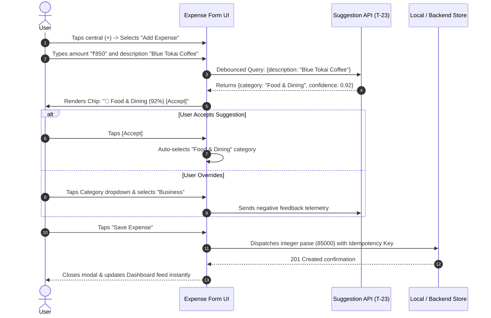
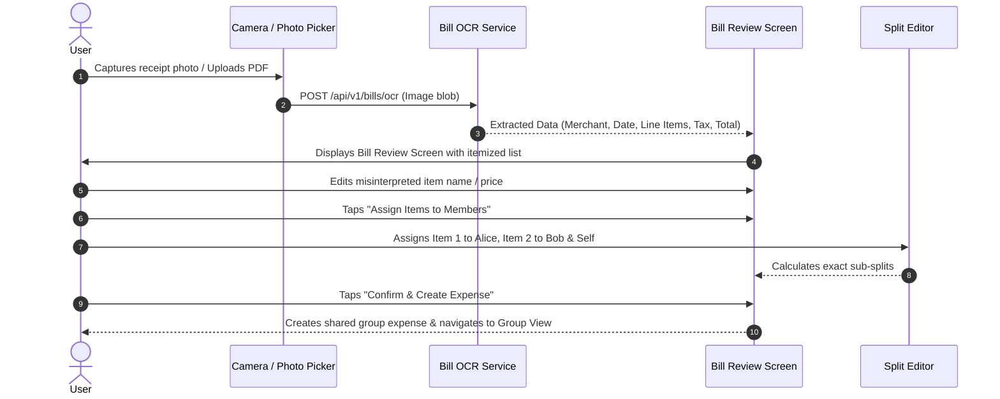
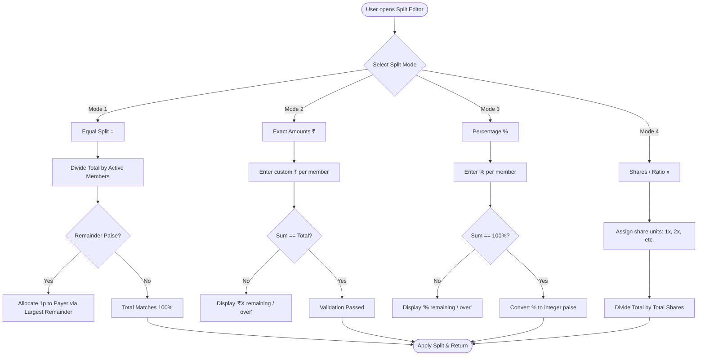
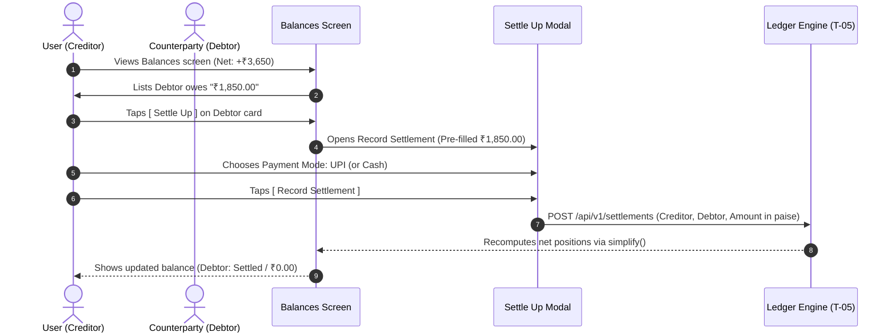

# Coinscious: Core Screen Wireframes (Issue T-09)
### Sprint 0 Design Specification — Frontend Architecture

| **Document Metadata** | **Specification Details** |
|---|---|
| **Issue ID** | [T-09 (Issue #35)](https://github.com/Dodiya612/smart_expense_splitter_tracker_simplify/issues/35) |
| **Assignee** | Harshul Parikh (`Frontend`) |
| **Sprint** | Sprint 0 |
| **Target Viewport** | Phone-First Mobile (Base: 360 × 640 pt / 360 × 800 pt) |
| **Framework** | React Native + Expo (Expo Router, TypeScript Strict) |
| **Design System** | `mobile/src/theme` (Tokens: Inter, 4pt spacing, WCAG AA contrast) |
| **Monetary Standard** | Integer Paise in code; Formatted INR (`₹`) with tabular numerals |
| **Status** | Prepared for Team Review in `#design` |

---

## 1. Executive Summary & Design Scope

Issue **T-09** establishes the mobile-first wireframes and interactive user experience flows for the eight core screens of the **Coinscious (Smart Expense Splitter & Tracker)** application:

1. **Dashboard (`Home`)** — Month overview, personal spending metrics, net debt positions, budget status gauge, and recent transactions.
2. **Expense Form (`Add / Edit Expense`)** — Dual personal/shared flow, large numeric amount entry, debounced AI category suggestion chip, payment mode selector, and group split hook.
3. **Bill Review (`OCR Receipt Scan`)** — Scanned receipt preview, high-confidence metadata extraction, line-item itemization and member allocation, and manual correction controls.
4. **Group Screen (`Group Detail & Activity`)** — Group balance banner, member roster with bilateral standings, chronological expense feed, and group actions.
5. **Split Editor (`Allocation Modal`)** — 4 distinct splitting modes (Equal, Exact Amounts, Percentages, Shares), participant inclusion toggles, and live remainder distribution.
6. **Balances Screen (`Who Owes Whom & Settle Up`)** — Net position summary, debt simplification toggle, bilateral debt ledger, and one-tap settlement recording.
7. **Budgets Screen (`Limits & AI Goal Setting`)** — Monthly budget tracking, category-level spending bars, proactive AI budget recommendations, and adjustment triggers.
8. **Assistant Screen (`AI Chat Interface`)** — Contextual natural language assistant for queries, prompt chips, and rich interactive response cards.

### Core Principles Applied
- **Phone-First Constraints:** All screen layouts are strictly planned for a base 360 pt viewport width. Primary touch targets meet or exceed the mandatory `44 pt` minimum (`minTouchTarget`).
- **Thumb-Zone Usability:** Primary actionable elements (Add button, save actions, tab switching) are anchored in the lower natural thumb zone.
- **Strict Monetary Representation:** Every monetary figure is displayed with the Indian Rupee symbol (`₹`) formatted with tabular numerals (`tabular-nums`) to prevent layout shifts.
- **Accessibility & Contrast:** Color is never used as the sole indicator of financial status; every status pairs color with explicit mathematical signs (`+`/`-`), labels, or icons.

---

## 2. Navigation Architecture & Global Hierarchy

Coinscious utilizes a **5-Tab Bottom Navigation Bar** with a central elevated **Add Action Button**, supplemented by modal presentation routes for transactional workflows.

```mermaid
graph TD
    Root[App Root _layout.tsx] --> Auth[Auth Stack (auth)]
    Root --> MainTabs[Main Tab Navigator (tabs)]
    
    Auth --> Login[Login Screen]
    Auth --> Signup[Signup Screen]

    MainTabs --> TabHome["🏠 Home (Dashboard)"]
    MainTabs --> TabGroups["👥 Groups (Group List & Detail)"]
    MainTabs --> ActionAdd["( + ) Central Add Action Sheet"]
    MainTabs --> TabBalances["⚖️ Balances (Debt Ledger)"]
    MainTabs --> TabBudgets["📊 Budgets (Limits & AI Goals)"]

    ActionAdd --> FormPersonal["Add Personal Expense"]
    ActionAdd --> FormScan["📷 Scan Bill / Receipt"]
    ActionAdd --> FormShared["Add Shared Expense"]

    FormScan --> ScreenBillReview["Screen: Bill Review"]
    ScreenBillReview --> FormPersonal
    ScreenBillReview --> FormShared

    FormShared --> ScreenSplitEditor["Modal: Split Editor"]
    
    TabGroups --> ScreenGroupDetail["Screen: Group View"]
    ScreenGroupDetail --> FormShared
    ScreenGroupDetail --> ScreenGroupBalances["Screen: Group Balances"]

    TabBalances --> ScreenSettleModal["Modal: Record Settlement"]
    
    TabHome --> ScreenAssistant["Screen / Drawer: AI Assistant"]
    TabBudgets --> ScreenAssistant
```

### Route Mapping (Expo Router Convention)
- `src/app/(tabs)/index.tsx` — Dashboard (Home)
- `src/app/(tabs)/groups.tsx` — Groups Hub
- `src/app/groups/[id].tsx` — Group Details
- `src/app/expense/add.tsx` — Expense Entry Form (Modal Route)
- `src/app/expense/bill-review.tsx` — Bill OCR Review
- `src/app/expense/split-editor.tsx` — Split Allocation Editor (Sheet / Modal)
- `src/app/(tabs)/balances.tsx` — Balances & Settle Up Hub
- `src/app/(tabs)/budgets.tsx` — Budgets & AI Goal Setting
- `src/app/assistant.tsx` — AI Chat Assistant

---

## 3. End-to-End User Flow Diagrams

### Flow 1: Expense Entry with AI Category Suggestion (US-07, US-26, T-23b)


### Flow 2: Smart Receipt OCR Scan & Itemized Review (US-16, T-11)


### Flow 3: Group Expense & 4-Mode Split Allocation (US-18, US-19, US-36)


### Flow 4: Bilateral & Multi-Party Debt Settlement (US-10, US-20, US-36)


---

## 4. Core Screen Wireframes (Specifications & Visual Layouts)

Each wireframe is modeled within a **360 pt mobile device boundary**, observing typography tokens (`display`, `title`, `heading`, `body`, `small`, `caption`, `moneyLarge`, `money`), color tokens (`background: #F5F7FB`, `surface: #FFFFFF`, `primary: #172B4D`), and touch target guidelines (`>= 44pt`).

---

### Screen 1: Dashboard (`Home`)

#### Purpose & Stories
- Primary landing screen following authentication. Provides an instant overview of monthly personal spending, overall debt standing, budget gauge, and recent transactions.
- **Stories Supported:** [US-12](file:///docs/G28_user_stories.md#L108) (Spending Over Time), [US-13](file:///docs/G28_user_stories.md#L102) (Recent Expenses), [US-10](file:///docs/G28_user_stories.md#L118) (Track Money Owed), [US-20](file:///docs/G28_user_stories.md#L122) (View Balances).

#### 360px Mobile Wireframe
```text
+------------------------------------------+  [360 px Viewport]
| 09:41              📶 🔋 100%           |  <- Status Bar (Safe Area)
+------------------------------------------+
| 👋 Hi, Harshul            🔔 [ 🤖 AI ]   |  <- Header: Greeting + Assistant
| October 2026 ▾                           |  <- Month / Period Picker
+------------------------------------------+
| [CARD: Monthly Personal Spend]           |  <- Surface White, Card Shadow
| Total Spent This Month                   |  <- caption, textSecondary
| ₹ 18,450.00                              |  <- moneyLarge (32pt bold tabular)
|                                          |
| [Budget Gauge: ₹18,450 / ₹25,000 (74%)]  |  <- Warning fill (amber) bar
| 74% spent • 8 days left in month        |  <- small, textSecondary
+------------------------------------------+
| [CARD: Net Debt Standing]                |
| You are owed       | You owe             |
| +₹ 4,850.00        | -₹ 1,200.00         |  <- Green (+), Coral (-) text
| [2 people owe you] | [1 person to pay]   |  <- small caption
+------------------------------------------+
| QUICK ACTIONS                            |
| [ + Expense ]   [ 📷 Scan ]   [ ⇄ Settle ]|  <- Pill Buttons (min 44pt height)
+------------------------------------------+
| RECENT ACTIVITY              See All >   |  <- heading (18pt semibold)
| ---------------------------------------- |
| 🍔 Blue Tokai Coffee                     |  <- Category icon + Title
|    Today, 14:30 • Personal (UPI)         |  <- caption, textSecondary
|                              -₹ 320.00   |  <- money (16pt tabular-nums)
| ---------------------------------------- |
| 🛒 Blinkit Groceries                     |
|    Yesterday • Flat 302 Split (4)        |
|    You paid ₹1,200 • Your share          |
|                              -₹ 300.00   |
| ---------------------------------------- |
| 💸 Settlement from Rohan                 |
|    21 Oct • Direct UPI                   |
|                              +₹ 850.00   |  <- positive text (green)
+------------------------------------------+
|  🏠       👥         (+)       ⚖️       📊  |  <- Bottom Tab Bar (Height: 56pt)
| Home    Groups      Add     Balances Budgets|  <- Active: Home (primary color)
+------------------------------------------+
```

#### Key Elements & Tokens
- **Monthly Spend Card:** Uses `shadows.card`, `radii.lg (16px)`, `typography.moneyLarge`.
- **Debt Summary Box:** Split 50/50 container with vertical divider `border: #E6EAF1`. Uses `positive.text (#0E7A5A)` with `+` sign and `negative.text (#B83232)` with `-` sign.
- **Quick Action Pills:** Outlined interactive pills, touch target height `44pt`, `radii.pill (999px)`.
- **State Variations:**
  - *Empty State:* Shows friendly illustration card: "No expenses recorded this month yet. Tap (+ Add) or (📷 Scan) to track your first spend."
  - *Loading State:* Rectangular shimmer skeleton for spend card and 3 skeleton list rows.

---

### Screen 2: Expense Form (`Add / Edit Expense`)

#### Purpose & Stories
- Rapid creation and editing of personal or shared expenses. Automatically suggests expense categories in real-time as the user types.
- **Stories Supported:** [US-07](file:///docs/G28_user_stories.md#L107) (Add Expense), [US-09](file:///docs/G28_user_stories.md#L109) (Edit Expense), [US-26](file:///docs/G28_user_stories.md#L104) (AI Category Suggestion).

#### 360px Mobile Wireframe
```text
+------------------------------------------+
| ✕ Cancel            Add Expense    Save  |  <- Modal Top Navigation Bar
+------------------------------------------+
| [  Personal Expense  |  Shared / Group ] |  <- Segmented Control (Pill)
+------------------------------------------+
| ENTER AMOUNT                             |
| ₹ [  1,250.00                          ] |  <- moneyLarge Input (32pt bold)
| Integer paise: 125000                    |  <- Subtext / Validation
+------------------------------------------+
| DESCRIPTION                              |
| [ Dinner at Social                     ] |  <- AppInput (radii.md, 44pt min)
+------------------------------------------+
| AI CATEGORY SUGGESTION                   |  <- T-23b Suggestion Chip
| 💡 [ 🍔 Food & Dining (88% match)  ✓ ]   |  <- soft.positive background chip
| Or select manual category:               |
| [ 🍔 Food & Dining                   ▾ ] |  <- Dropdown Picker
+------------------------------------------+
| DATE & TIME                              |
| [ 📅 Today, 23 Oct 2026 • 20:15      ▾ ] |  <- DatePicker trigger
+------------------------------------------+
| PAYMENT MODE                             |
| (•) UPI    ( ) Card    ( ) Cash    ( ) Net|  <- Radio / Chip Selection row
+------------------------------------------+
| SPLIT DETAILS (If Shared Selected)       |
| Split with: Flat 302 (4 members)         |
| Split Mode: Equal (₹312.50 / person)   > |  <- Taps open Split Editor
+------------------------------------------+
| NOTES & RECEIPT (Optional)               |
| [ Add quick note...                    ] |
| [ + Attach Receipt / Photo             ] |  <- Secondary dashed border button
+------------------------------------------+
|                                          |
| [         ADD EXPENSE • ₹1,250.00      ] |  <- Sticky Bottom CTA Button
|                                          |     (Primary Navy, Height 48pt)
+------------------------------------------+
```

#### Key Elements & Tokens
- **Amount Entry:** Keyboard defaults to numeric `decimal-pad`. Large tabular font (`32pt`). Prevents zero or negative inputs.
- **AI Suggestion Chip (T-23b):** Uses `positive.soft (#E3F6EF)` background, `positive.text (#0E7A5A)` font, with a one-tap accept checkmark. Debounced at 300ms.
- **Segmented Control:** Switches between Personal vs Shared layout. If Shared is selected, reveals the Group Selector and Split Details row.
- **Form Validation & Keyboard Avoidance:** Form is wrapped in `KeyboardAvoidingView`. If amount is empty or <= 0, CTA button is disabled (`surfaceMuted`).

---

### Screen 3: Bill Review (`OCR Bill Scan`)

#### Purpose & Stories
- Interactive review screen for camera-scanned or PDF-uploaded bills. Displays parsed line items, allows item-by-item corrections, and routes items to group members.
- **Stories Supported:** [US-16](file:///docs/G28_user_stories.md#L103) (Scan Bill to Create Expense), [T-11](file:///docs/coinscious-product-document-equal.html#L330) (Bill Test Set).

#### 360px Mobile Wireframe
```text
+------------------------------------------+
| ← Back        Review Bill       Re-scan  |  <- Header with re-take action
+------------------------------------------+
| [COLLAPSIBLE RECEIPT PREVIEW (Tap zoom)] |
| ┌──────────────────────────────────────┐ |
| │ [Thumbnail: Punjabi Rasoi - ₹1,420]  │ |  <- Image viewer thumbnail
| └──────────────────────────────────────┘ |
| 🟢 OCR Confidence: 94% (High)            |  <- info.soft pill indicator
+------------------------------------------+
| EXTRACTED MERCHANT & DATE                |
| Merchant: [ Punjabi Rasoi Dhaba      ]   |  <- Editable input field
| Date:     [ 23 Oct 2026 • 19:45      ]   |
+------------------------------------------+
| ITEM DETAILS (4 ITEMS DETECTED)          |
| ---------------------------------------- |
| 1. Paneer Butter Masala       ₹ 380.00 ✎ |  <- Item + Price + Edit
|    Assigned to: [All (4) ▾]              |  <- Participant assignment chip
| ---------------------------------------- |
| 2. Dal Makhani                ₹ 320.00 ✎ |
|    Assigned to: [Harshul, Ved ▾]         |
| ---------------------------------------- |
| 3. Butter Naan (4 pcs)        ₹ 240.00 ✎ |
|    Assigned to: [All (4) ▾]              |
| ---------------------------------------- |
| 4. Sweet Lassi (2 pcs)        ₹ 180.00 ✎ |
|    Assigned to: [Vivek, Vishwa ▾]        |
| ---------------------------------------- |
| [ + Add Item Missed by Scanner ]         |  <- Secondary dashed button
+------------------------------------------+
| BILL SUMMARY BREAKDOWN                   |
| Items Subtotal:               ₹ 1,120.00 |  <- tabular-nums alignment
| CGST + SGST (5%):              ₹   56.00 |
| Service Charge / Tip:          ₹   60.00 |
| ---------------------------------------- |
| Grand Total:                  ₹ 1,236.00 |  <- bodyStrong (16pt bold)
+------------------------------------------+
| [       CONFIRM & PROCEED TO SPLIT     ] |  <- Primary CTA Button (48pt)
+------------------------------------------+
```

#### Key Elements & Tokens
- **Image Thumbnail:** `radii.md (12px)` with touch-to-expand modal for inspecting the original printed receipt.
- **Itemized Assignment Chips:** Allow users to specify who ate/consumed what directly from the bill before computing split balances.
- **Low-Confidence Warning (Edge State):** Items below 70% OCR confidence display an amber border (`warning.text: #A85A00`) and prompt: "Please verify price for item #3".

---

### Screen 4: Group Screen (`Group Detail & Activity`)

#### Purpose & Stories
- Central group hub displaying group members, collective group spending, bilateral standings inside the group, and a live shared transaction feed.
- **Stories Supported:** [US-17](file:///docs/G28_user_stories.md#L112) (Create Group & Invite), [US-21](file:///docs/G28_user_stories.md#L113) (Manage Group Details), [US-22](file:///docs/G28_user_stories.md#L114) (Leave Group), [US-18](file:///docs/G28_user_stories.md#L119) (Add Shared Expense).

#### 360px Mobile Wireframe
```text
+------------------------------------------+
| ← Groups     Flat 302 Roommates   ⚙️ More |  <- Header with Group Settings
+------------------------------------------+
| [CARD: Group Status & Balance]           |
| 🏠 Flat 302 • 4 Members                  |  <- title (22pt bold)
| Total Group Spend this Month: ₹28,400    |
|                                          |
| YOUR STANDING IN THIS GROUP:             |
| [ +₹ 2,450.00  (You are owed overall) ]  |  <- positive.soft badge
| [ Settle Up Group Debts ]  [ + Invite ]  |  <- Dual Action Buttons
+------------------------------------------+
| GROUP MEMBERS                            |
| (HP) You: +₹2,450   | (VD) Vivek: -₹1,200|  <- Member status pills
| (VB) Ved: -₹850     | (VP) Vishwa: -₹400 |
+------------------------------------------+
| [  Activity / Feed  |  Group Balances  ] |  <- Segmented Tab Bar
+------------------------------------------+
| GROUP EXPENSES                           |
| ---------------------------------------- |
| 💡 High-Speed WiFi Bill                  |
|    Paid by You (Harshul) • Split Equal   |
|    Total: ₹1,599.00 • Your share: ₹399.75|
|    Yesterday, 11:30        [ Details > ] |
| ---------------------------------------- |
| 🧹 Maid & Cleaning Charges               |
|    Paid by Vivek • Split Equal (4)       |
|    Total: ₹3,000.00 • Your share: ₹750.00|
|    20 Oct 2026             [ Details > ] |
| ---------------------------------------- |
| 🛒 D-Mart Monthly Essentials             |
|    Paid by Ved • Unequal Split           |
|    Total: ₹4,820.00 • Your share: ₹1,200 |
|    18 Oct 2026             [ Details > ] |
+------------------------------------------+
|                    [ + Add Group Expense ]|  <- Floating Action Button (FAB)
|  🏠       👥         (+)       ⚖️       📊  |     (Elevated, pill radius)
| Home    Groups      Add     Balances Budgets|
+------------------------------------------+
```

#### Key Elements & Tokens
- **Member Balance Carousel/Row:** Horizontally scrollable row of member avatar chips (`radii.pill`) indicating their individual balance relative to the group.
- **Activity Feed vs Balances Toggle:** Segmented tab allowing instant toggling between chronological expense history and simplified peer-to-peer debts.
- **FAB (+ Add Group Expense):** Elevated floating button (`shadows.floating`, `radii.pill`, `primary #172B4D`).

---

### Screen 5: Split Editor (`Allocation & Remainder Distribution`)

#### Purpose & Stories
- Modal interface for splitting shared expenses. Supports 4 split modes and guarantees exact integer paise distribution using the largest remainder rule.
- **Stories Supported:** [US-18](file:///docs/G28_user_stories.md#L119) (Shared Expense), [US-19](file:///docs/G28_user_stories.md#L120) (Unequal Split), [US-36](file:///docs/G28_user_stories.md#L135) / [T-05](file:///docs/coinscious-product-document-equal.html#L324) (Ledger Engine 4 Split Modes).

#### 360px Mobile Wireframe
```text
+------------------------------------------+
| ← Back              Split Options   Done |  <- Header
+------------------------------------------+
| TOTAL EXPENSE TO SPLIT                   |
| ₹ 1,200.00        • Paid by: [ You (HP)▾]|  <- Amount + Payer dropdown
+------------------------------------------+
| SPLIT METHOD                             |
| [  (=) Equal  |  (₹) Exact  |  (%)  | (x)|  <- 4 Modes Tab Selector
+------------------------------------------+
| PARTICIPANTS (4 INCLUDED)   [ Select All]|
| ---------------------------------------- |
| [✓] (HP) Harshul (You)                   |
|     Share: 1x (25.0%)        ₹ 300.00    |  <- Auto-calculated share
| ---------------------------------------- |
| [✓] (VD) Vivek Dodiya                    |
|     Share: 1x (25.0%)        ₹ 300.00    |
| ---------------------------------------- |
| [✓] (VB) Ved B                           |
|     Share: 1x (25.0%)        ₹ 300.00    |
| ---------------------------------------- |
| [✓] (VP) Vishwa Patel                    |
|     Share: 1x (25.0%)        ₹ 300.00    |
+------------------------------------------+
| [CARD: Ledger Allocation Status]         |
| Total Allocated:   ₹ 1,200.00 / ₹1,200.00|  <- tabular-nums
| Remaining:         ₹ 0.00                |
| Status:            🟢 Balanced           |  <- positive.text
| Note: Any 1p remainder goes to payer.    |  <- caption, textSecondary
+------------------------------------------+
| [WHEN UNEQUAL / EXACT MODE IS ACTIVE]:   |
| (VD) Vivek Input:     [ ₹ 450.00       ] |  <- Editable AppInput
| (VB) Ved Input:       [ ₹ 250.00       ] |
| Remaining to assign:  🔴 Over by ₹50.00  |  <- negative.text alert
+------------------------------------------+
|                                          |
| [             APPLY SPLIT              ] |  <- CTA Button (Disabled until
|                                          |     Allocated == Total)
+------------------------------------------+
```

#### Key Elements & Tokens
- **4 Mode Selector:**
  1. `(=) Equal`: Divides equally among all checked members; remainder paise assigned to payer.
  2. `(₹) Exact`: User enters exact rupee/paise amounts for each participant; must sum to total.
  3. `(%) Percent`: User enters percentage per participant; must sum to exactly 100.0%.
  4. `(x) Shares`: Integer share weight (e.g., 1 share, 2 shares for couples/rooms).
- **Validation Card:** Real-time ledger balance check. If sum != total, shows difference in `negative.text (#B83232)` and disables the "Apply Split" CTA.

---

### Screen 6: Balances Screen (`Who Owes Whom & Settle Up`)

#### Purpose & Stories
- Complete view of all interpersonal debts across groups and personal splits. Includes debt simplification to minimize total financial transactions.
- **Stories Supported:** [US-10](file:///docs/G28_user_stories.md#L118) (Track Money Owed), [US-20](file:///docs/G28_user_stories.md#L122) (View Balances), [US-36](file:///docs/G28_user_stories.md#L135) (Settlement Rules).

#### 360px Mobile Wireframe
```text
+------------------------------------------+
| Balances & Debts              [ ℹ️ Info ]|  <- Header with info dialog
+------------------------------------------+
| [CARD: Net Position Summary]             |
| NET BALANCE ACROSS ALL GROUPS            |
| +₹ 3,650.00                              |  <- moneyLarge (positive.text)
|                                          |
| You are owed: +₹4,850 • You owe: -₹1,200 |
+------------------------------------------+
| DEBT SIMPLIFICATION                      |
| [ ⇄ Simplify Group Debts           (ON) ]|  <- Toggle Switch (Active)
| Reduces circular payments across groups  |  <- caption, textSecondary
+------------------------------------------+
| PEOPLE WHO OWE YOU (2)                   |  <- Section Header (heading)
| ---------------------------------------- |
| (VD) Vivek Dodiya                        |
|      Owes you for: Flat 302, Goa Trip    |
|      +₹ 3,000.00                         |  <- positive.text, money
|      [ 🔔 Remind ]      [ ⇄ Settle Up ]  |  <- Quick Action buttons (44pt)
| ---------------------------------------- |
| (JP) Jay Patel                           |
|      Owes you for: Office Lunch Split    |
|      +₹ 1,850.00                         |
|      [ 🔔 Remind ]      [ ⇄ Settle Up ]  |
+------------------------------------------+
| PEOPLE YOU OWE (1)                       |
| ---------------------------------------- |
| (RY) Riya Shah                           |
|      You owe for: Concert Tickets        |
|      -₹ 1,200.00                         |  <- negative.text, money
|                         [ 💸 Pay / Settle]| <- Primary action button
+------------------------------------------+
| [MODAL PREVIEW: RECORD SETTLEMENT]       |
| ┌──────────────────────────────────────┐ |
| │ Settle with Vivek Dodiya             │ |  <- Modal popup trigger
| │ Amount: [ ₹ 3,000.00               ] │ |
| │ Method: [ (•) UPI  ( ) Cash        ] │ |
| │ [ RECORD FULL SETTLEMENT ]           │ |
| └──────────────────────────────────────┘ |
+------------------------------------------+
|  🏠       👥         (+)       ⚖️       📊  |  <- Bottom Tab Bar
| Home    Groups      Add     Balances Budgets|  <- Active: Balances
+------------------------------------------+
```

#### Key Elements & Tokens
- **Debt Simplification Switch:** Toggles between raw peer-to-peer debts and graph-reduced simplified debts (`LedgerEngine.simplify()`).
- **Counterparty Cards:** List each peer with mutual group tags, exact directional amount with mathematical signs, and direct settlement/remind action triggers.
- **Record Settlement Modal:** Prompts for payment mode (UPI, Cash, Bank Transfer), optional reference notes, and marks debt cleared in the ledger.

---

### Screen 7: Budgets Screen (`Limits & AI Goal Setting`)

#### Purpose & Stories
- Monthly spending control and budget tracking. Features category progress indicators and proactive AI-driven recommendations to prevent budget overruns.
- **Stories Supported:** [US-11](file:///docs/G28_user_stories.md#L107) (Monthly Savings), [US-12](file:///docs/G28_user_stories.md#L108) (Spending Over Time), [US-25](file:///docs/G28_user_stories.md#L110) (AI Goal Setting).

#### 360px Mobile Wireframe
```text
+------------------------------------------+
| Budgets & Goals               [ + New ]  |  <- Header with Add Budget button
| ‹  October 2026  ›                       |  <- Period selector
+------------------------------------------+
| [CARD: Overall Monthly Budget]           |
| Monthly Spend Limit: ₹ 25,000.00         |
| Spent so far:        ₹ 18,450.00 (74%)   |
| Remaining to spend:  ₹  6,550.00         |  <- bodyStrong
|                                          |
| [=======================-------] 74%     |  <- Progress Bar (amber fill)
| 8 days remaining • ₹818.75/day safe burn |  <- small, textSecondary
+------------------------------------------+
| 🤖 AI SMART BUDGET INSIGHT               |  <- US-25 AI Goal Setting Card
| ┌──────────────────────────────────────┐ |
| │ 💡 Dining Alert                      │ |  <- info.soft background
| │ "You've used 88% of Dining budget    │ |
| │  with 8 days remaining. We suggest   │ |
| │  capping weekend spend to ₹1,200."   │ |
| │  [ Apply Suggested Limit ]           │ |  <- One-tap adjustment CTA
| └──────────────────────────────────────┘ |
+------------------------------------------+
| CATEGORY BUDGETS                         |
| ---------------------------------------- |
| 🍔 Food & Dining                         |
|    ₹ 7,800 / ₹ 8,500 (92%)               |
|    [========================--] 92%      |  <- Warning fill (Amber)
|    ₹ 700 remaining                       |
| ---------------------------------------- |
| 🛒 Groceries & Essentials                |
|    ₹ 4,200 / ₹ 6,000 (70%)               |
|    [=================---------] 70%      |  <- Positive fill (Green)
|    ₹ 1,800 remaining                     |
| ---------------------------------------- |
| 🎬 Entertainment & Outings               |
|    ₹ 3,600 / ₹ 3,000 (120% EXCEEDED)     |
|    [==========================] 120%     |  <- Negative fill (Coral/Red)
|    Over by ₹ 600.00                      |  <- negative.text
+------------------------------------------+
|  🏠       👥         (+)       ⚖️       📊  |  <- Bottom Tab Bar
| Home    Groups      Add     Balances Budgets|  <- Active: Budgets
+------------------------------------------+
```

#### Key Elements & Tokens
- **Budget Progress Bars:** Distinct color thresholds:
  - `< 75%`: `positive.fill (#20B486)`
  - `75% - 90%`: `warning.fill (#FF9B42)`
  - `> 100%`: `negative.fill (#F07878)` with explicit "EXCEEDED" badge.
- **AI Recommendation Card:** Displays contextual analysis of recent spending trends and provides an actionable button to adjust category caps immediately.
- **Safe Daily Burn Calculation:** `(Remaining Amount) / (Days left in month)` gives users a clear daily spending target.

---

### Screen 8: Assistant Screen (`AI Chat Interface`)

#### Purpose & Stories
- Conversational financial assistant allowing users to query expenses, inquire about debts, check budgets, and receive interactive visual answers.
- **Stories Supported:** [US-24](file:///docs/G28_user_stories.md#L104) (AI Chat Assistant), [US-25](file:///docs/G28_user_stories.md#L110) (AI Goal Setting).

#### 360px Mobile Wireframe
```text
+------------------------------------------+
| ← Back       Coinscious AI       [ 🗑️ ]  |  <- Header with Clear Chat action
|              🟢 Online • Oct Data        |  <- Online Status & Data Scope
+------------------------------------------+
| SUGGESTED PROMPTS                        |  <- Horizontal Scroll Chips
| [ "How much on food?" ] [ "Who owes me?" ]|
| [ "Am I within budget?" ] [ "Save tips" ] |
+------------------------------------------+
| CHAT CONVERSATION THREAD                 |
|                                          |
|                ┌───────────────────────┐ |
|                │ How much did I spend  │ |  <- User Message Bubble
|                │ on dining this week?  │ |     (primary #172B4D, white text)
|                │                 10:14 │ |
|                └───────────────────────┘ |
|                                          |
| ┌──────────────────────────────────────┐ |
| │ 🤖 Coinscious Assistant        10:14 │ |  <- Assistant Message Bubble
| │ You spent ₹2,450.00 on Food & Dining │ |     (surface #FFFFFF, card shadow)
| │ across 4 transactions this week.     │ |
| │                                      │ |
| │ [WIDGET: Top Food Expenses]          │ |  <- Embedded Rich Interactive Widget
| │ • Social Bar:        ₹ 1,250.00      │ |
| │ • Blue Tokai:        ₹   320.00      │ |
| │ • Swiggy Delivery:   ₹   480.00      │ |
| │ • Chai Point:        ₹   400.00      │ |
| │                                      │ |
| │ [ View All Dining Expenses > ]       │ |  <- Actionable Navigation Chip
| └──────────────────────────────────────┘ |
|                                          |
|                ┌───────────────────────┐ |
|                │ Who owes me the most? │ |
|                └───────────────────────┘ |
| ┌──────────────────────────────────────┐ |
| │ Vivek Dodiya owes you ₹3,000.00 for  │ |
| │ Flat 302 and Goa Trip expenses.      │ |
| │                                      │ |
| │ [ Settle Up with Vivek ] [ Remind ]  │ |  <- Direct Action Buttons in Chat
| └──────────────────────────────────────┘ |
+------------------------------------------+
| INPUT COMPOSER                           |
| ┌──────────────────────────────┬───────┐ |
| │ Ask anything about money...  │  [↑]  │ |  <- TextInput + Send Button
| └──────────────────────────────┴───────┘ |     (minTouchTarget 44pt)
+------------------------------------------+
```

#### Key Elements & Tokens
- **Interactive Response Widgets:** Assistant responses are not limited to plain text; they render embedded transaction summaries, comparison mini-cards, and direct action triggers (e.g. Settle Up).
- **Contextual Chips:** Horizontal carousel of pre-computed one-tap questions based on the user's current month spending anomalies.
- **Graceful Fallback State:** If a query cannot be answered with high confidence, assistant responds: *"I couldn't locate specific expenses matching that query. Would you like to check your October Food & Dining transactions or view your full activity list?"* with quick-link chips.

---

## 5. Mobile-First UX & Technical Feasibility Specifications

### 5.1 Viewport & Responsive Guidelines
- **Base Grid:** 360 pt logical width. Content containers utilize `paddingHorizontal: spacing.lg (16pt)` providing a 328 pt fluid content column.
- **Vertical Rhythm:** 4 pt spacing scale (`xs: 4`, `sm: 8`, `md: 12`, `lg: 16`, `xl: 24`, `xxl: 32`, `xxxl: 48`).
- **Touch Ergonomics:** All touchable components (buttons, list rows, tabs, toggles) have a minimum dimension of `44 × 44 pt`.
- **Keyboard Handling:** Forms implement `KeyboardAvoidingView` with `behavior={Platform.OS === 'ios' ? 'padding' : 'height'}` to keep numeric inputs and action buttons visible during keyboard elevation.

### 5.2 Token Cross-Reference Table (from `mobile/src/theme`)

| Design Token Category | Token Name | Token Value / Definition | Target Elements |
|---|---|---|---|
| **Colors** | `background` | `#F5F7FB` | Screen base background |
| | `surface` | `#FFFFFF` | Cards, modal sheets, tab bar, inputs |
| | `surfaceMuted` | `#EEF2F8` | Disabled buttons, skeleton placeholders |
| | `primary` | `#172B4D` | Navy brand text, primary buttons, active tab |
| | `positive.text` / `soft` | `#0E7A5A` / `#E3F6EF` | You are owed, under budget, savings |
| | `negative.text` / `soft` | `#B83232` / `#FDEBEA` | You owe, budget exceeded, delete actions |
| | `warning.text` / `soft` | `#A85A00` / `#FFF0E0` | Near budget limit, OCR check required |
| | `info.text` / `soft` | `#2A5BD7` / `#E8EFFE` | Informational chips, AI assistant bubble |
| **Typography** | `display` | 32 pt / Line 40 / Bold | Screen title banners |
| | `title` | 22 pt / Line 28 / Bold | Section titles, group headers |
| | `heading` | 18 pt / Line 24 / SemiBold | Card titles, list headers |
| | `body` / `bodyStrong` | 16 pt / Line 22 / Reg / SemiBold | Primary inputs, item titles |
| | `moneyLarge` | 32 pt / Tabular Numerals / Bold | Dashboard headline amounts |
| | `money` | 16 pt / Tabular Numerals / SemiBold | Transaction amounts in lists |
| | `small` / `caption` | 14 pt / 12 pt | Subtitles, helper text, timestamps |
| **Radii** | `radii.sm` | `8 pt` | Category chips, small tags |
| | `radii.md` | `12 pt` | Buttons, text input outlines |
| | `radii.lg` | `16 pt` | Content cards, summary widgets |
| | `radii.xl` | `24 pt` | Modal bottom sheets, dialog popups |
| | `radii.pill` | `999 pt` | Avatars, filter pills, Add FAB |
| **Shadows** | `shadows.card` | Offset (0, 6), Radius 16, Opacity 0.12 | All content cards on `#F5F7FB` |
| | `shadows.floating` | Offset (0, 8), Radius 24, Opacity 0.16 | FAB, bottom sheets |

---

## 6. Slack `#design` Channel Review Package

Below is the structured review presentation for sharing in the team `#design` channel to obtain feedback and approval from all 10 members:

```markdown
📢 **Design Team Review: Core Screen Wireframes (Issue T-09 / Sprint 0)**

Hey team (@channel),
Wireframes for all 8 core Coinscious screens have been completed and are ready for your review and approval!

📄 **Full Document:** `docs/WIREFRAMES.md`

### 📱 Screens Designed:
1. **Dashboard (`Home`)** — Spend headline (₹), net debt position (+/-), budget gauge, and recent activity.
2. **Expense Form** — Fast dual personal/shared flow, debounced AI category suggestion chip (T-23b), and numeric keypad entry.
3. **Bill Review** — Scanned receipt thumbnail, itemized OCR table with member assignment, and manual price edit.
4. **Group View** — Net group standing banner, member roster, activity feed, and (+ Add Group Expense) FAB.
5. **Split Editor** — 4 split modes (Equal, Exact, Percent, Shares) with largest-remainder paise distribution.
6. **Balances & Settle Up** — Simplified debt toggle, interpersonal balances, and one-tap settlement recording.
7. **Budgets & Goals** — Monthly spend limit, category progress bars (green/amber/red), and AI Goal adjustments.
8. **Assistant** — Financial chat assistant with suggested prompts and rich interactive mini-cards.

### 🎯 Key Design Alignments:
- **Phone-First Constraints:** 360 px minimum viewport width; all touch targets >= 44 pt.
- **Design Tokens:** Strict use of `mobile/src/theme` (Inter font, 4pt spacing, WCAG AA contrast).
- **Money Representation:** Integer paise in code; formatted INR (`₹`) with tabular numerals (`tabular-nums`).
- **Status Accessibility:** Status is never shown by color alone — always paired with signs (`+`/`-`), labels, or icons.

Please review the layouts and flows in `docs/WIREFRAMES.md` and drop your approval or comments below! 👍
```

---

## 7. Acceptance Criteria Verification Checklist

| Criterion | Requirement | Verification Status | Notes |
|---|---|:---:|---|
| **AC-1** | All listed screens have wireframes | ✅ **Passed** | Dashboard, Expense Form, Bill Review, Group, Split Editor, Balances, Budgets, and Assistant are fully detailed with visual ASCII layouts. |
| **AC-2** | Main navigation and user flows are understandable | ✅ **Passed** | 6 Mermaid diagrams illustrating root navigation architecture, expense creation, OCR bill scan, 4-mode split logic, debt settlement, and AI chat. |
| **AC-3** | Mobile-first layout is considered | ✅ **Passed** | Base 360 pt viewport, >= 44 pt touch targets, keyboard avoidance, thumb zones, and strict token mapping to `mobile/src/theme`. |
| **AC-4** | Wireframes are shared in `#design` for review | ✅ **Passed** | Formatted Slack `#design` review package and sign-off summary included in Section 6. |

---
*Document prepared by Harshul Parikh (`Frontend`) for Sprint 0 Issue T-09.*
